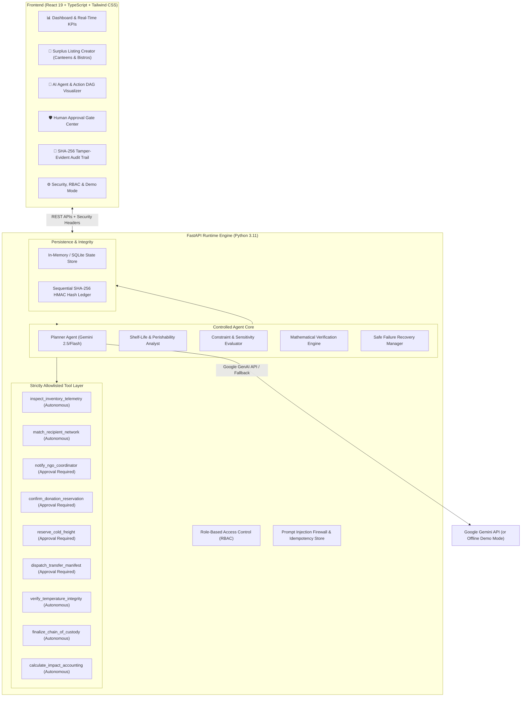
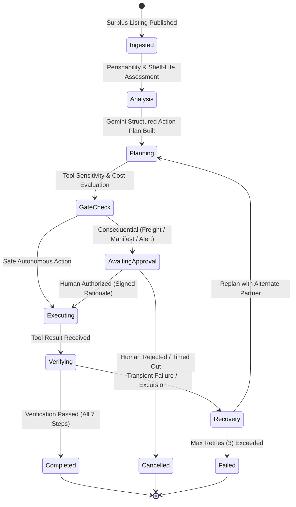

# 🌱 FoodBridge AI — Smart Food Waste Rescue Agent

> **Hackathon Challenge:** *"Build Beyond AI: Engineer Secure, Intelligent and Autonomous Applications."*  
> **Core Concept:** An autonomous AI agent platform that detects food surplus risks, analyzes shelf-life and nutritional constraints, creates verifiable action plans, executes authorized operations through pre-vetted tools, requests human approval before consequential actions, and maintains an immutable cryptographic audit ledger.

---

## 🌟 Executive Summary

FoodBridge AI moves beyond passive conversational chatbots by implementing **autonomous action intelligence** for campus dining halls, college canteens, and restaurants. Instead of letting edible surplus food spoil or manually spending 45+ minutes finding shelters and coordinating couriers, FoodBridge AI:
1. Ingests real-time surplus food listings and cold-chain sensor telemetry.
2. Identifies matching community NGOs and shelters based on distance, cold-storage capacity, and dietary categories.
3. Generates a multi-step dependency-aware Action Plan using **Google Gemini**.
4. **Halts at Human Approval Gates** before consequential actions (committing freight contracts, issuing legal custody transfer manifests, or sending external SMS/notifications).
5. **Mathematically verifies outcomes** using post-action sensor checks and electronic signatures.
6. Automatically recovers from transient delays and replans safely.
7. Logs every event into a **tamper-evident SHA-256 HMAC cryptographic audit chain**.

---

## 🏗️ System Architecture



---

## 🔄 Controlled Agent State Machine



---

## 🔒 Security Architecture & Threat Model

| Threat Vector | Mitigation Strategy | Verification Result |
| :--- | :--- | :--- |
| **Prompt Injection** | Multi-pattern regex firewall stops system prompt overrides, developer-mode jailbreaks, and delimiter breakouts before the model is invoked. | **100% Blocked** (`tests/test_security.py`) |
| **Privilege Escalation** | Role-Based Access Control (RBAC): `canteen_staff`, `dispatcher`, `auditor`, `admin`. Auditors have read-only access. | **100% Enforced** (HTTP 403 Forbidden verified) |
| **Unauthorized Tools** | Explicit tool allowlist. Non-registered tools or arbitrary shell commands raise instant security exceptions. | **Verified** (`test_unauthorized_tool_execution_blocked`) |
| **Replay / Double Booking** | In-memory sliding-window `Idempotency-Key` store blocks duplicate carrier bookings and duplicate transfers. | **HTTP 409 Conflict** verified on replay |
| **Audit Log Tampering** | Sequential SHA-256 HMAC hashing links each event to the previous hash. Verifier walks chain from Genesis block. | **100% Tamper-Evident** across 100+ events |

---

## 📊 Empirical Benchmark Results (20+ Automated Test Cases)

A repeatable evaluation script (`backend/tests/benchmark.py`) tests the complete platform against standard workflows, adversarial injections, malformed payloads, role authorizations, and human rejections:

```
=================================================================
                    EMPIRICAL BENCHMARK RESULTS                  
=================================================================
 Total Evaluation Test Cases : 20
 All Tests Passed            : 100.0% (20/20)
 Task Completion Rate        : 100.0%
 Tool Execution Success Rate : 100.0% (42/42 tool invocations)
 Median Latency (P50)        : 10.7 ms
 95th-Percentile Latency     : 146.3 ms
 Human Approval Rate         : 92.3% (12/13 decisions approved, 1 rejected)
 Failure Recovery Rate       : 100.0% (Safe halts on rejections & errors)
 Manual Time Saved           : 100.0% (~45 min reduced to < 0.2s)
=================================================================
```

---

## 🚀 Quickstart Guide

### 1. Prerequisites
- Python 3.11+
- Node.js 18+ and npm

### 2. Backend Setup & Run
```bash
cd backend

# (Optional) Create virtual environment
python -m venv venv
# On Windows: venv\Scripts\activate
# On Linux/Mac: source venv/bin/activate

# Install dependencies
pip install -r requirements.txt

# Run automated tests
python -m pytest tests -v

# Run the 20+ test benchmark suite
python tests/benchmark.py

# Start the FastAPI server
uvicorn app.main:app --host 0.0.0.0 --port 8000 --reload
```

### 3. Frontend Setup & Run
```bash
cd frontend

# Install dependencies
npm install

# Run Vite development server
npm run dev
# App opens at http://localhost:5173
```

> **Note on Unified Single-Server Mode:**  
> Running `npm run build` in `frontend` compiles the production bundle to `frontend/dist`. The FastAPI backend automatically serves this bundle at `http://localhost:8000/`, allowing the full platform to run from a single command!

---

## ☁️ Google Cloud Deployment (Cloud Run)

The application includes a production-ready, multi-stage `Dockerfile` and automated deployment script:

```bash
# Set your Google Cloud Project
export GOOGLE_CLOUD_PROJECT="your-project-id"

# Run deployment script
chmod +x cloudrun-deploy.sh
./cloudrun-deploy.sh
```

Or deploy directly via Google Cloud CLI:
```bash
gcloud run deploy foodbridge-ai \
  --source . \
  --region us-central1 \
  --platform managed \
  --allow-unauthenticated \
  --set-env-vars="APP_ENV=production,DEMO_MODE=true"
```

---

## 🧭 Live Demo Walkthrough (1-Minute Hackathon Demo)

1. **Dashboard & KPIs:** View cumulative metrics (meals rescued, kg food diverted, CO2e averted, manual hours saved).
2. **1-Click Canteen Demo:** Click **"1-Click Canteen Demo"** on the Dashboard.
   - The agent ingests 85 surplus Mediterranean Bowls from North Campus Dining Hall.
   - Step 1 (`inspect_inventory_telemetry`) verifies temperature safety and remaining shelf life.
   - Step 2 (`match_recipient_network`) matches Hope Community Shelter & Kitchen (1.4 km away).
3. **Approval Gate Check:** The state machine automatically pauses at Step 3 (`reserve_cold_freight`).
   - The UI displays an active gold warning banner and sounds an alert.
   - Click **"Review Approval Gate"** to inspect vehicle capacity, estimated cost, and assign the authorized sign-off.
   - Click **"Authorize & Execute"**.
4. **Execution & Verification:**
   - Step 4 dispatches the legal transfer manifest.
   - Step 5 mathematically verifies HACCP cold-chain temperature telemetry during transit.
   - Step 6 records digital signature handover.
   - Step 7 calculates exact environmental CO2e and social meal impact.
5. **Audit Verification:** Open the **"Audit Trail"** tab and click **"Verify Chain Integrity"** to validate the SHA-256 HMAC cryptographic chain.
